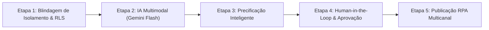

# 🗺️ Roadmap Estratégico de Engenharia — posta.ai

Este documento consolida o planejamento mestre, a arquitetura e os entregáveis técnicos das próximas etapas de evolução do **posta.ai**, servindo como guia permanente para retomada, auditoria e execução por agentes de software e desenvolvedores humanos.

---

## Visão Geral das Etapas

---

## 🔒 Etapa 1: Blindagem de Isolamento Local & Verificação RLS

> **Status:** Concluída | **Prioridade:** Máxima (Segurança e Integridade)

### Objetivos
- Garantir que nenhum vendedor consiga acessar, visualizar ou manipular dados e mídias de outro vendedor.
- Eliminar qualquer persistência residual de dados em memória volátil (heap do Hermes) ou armazenamento local (`AsyncStorage`) ao encerrar a sessão, inclusive offline.
- Criar suíte formal de testes SQL adversarial simulando múltiplos usuários no Supabase.

### Entregáveis Técnicos Concluídos
1. **Script de Verificação RLS (`supabase/verify_isolation.sql`):**
   - Transação atômica (`BEGIN; ... ROLLBACK;`) executável no Supabase SQL Editor.
   - Simulação determinística de dois vendedores (`Usuario_A` e `Usuario_B`) via JWT context (`auth.uid()`).
   - Teste de `SELECT`, `INSERT`, `UPDATE`, `DELETE` e rejeição de acessos forjados aprovado.
2. **Reforço de Integridade DDL:**
   - Adição de `NOTIFY pgrst, 'reload schema';` ao final de todas as migrações SQL para invalidar o schema cache obsoleto do PostgREST.
   - Reforço da restrição `NOT NULL DEFAULT auth.uid()` na coluna `user_id` de `produtos`.
3. **Purga Atômica no Logout Mobile:**
   - Inclusão de `resetProdutos()` no [`useProductStore`](file:///home/eduardorwll/Projects/posta-ai-app/src/store/useProductStore.ts).
   - Execução incondicional de limpeza de `useProductStore` e [`useDraftStore`](file:///home/eduardorwll/Projects/posta-ai-app/src/store/useDraftStore.ts) no bloco `finally` de `useAuthStore.signOut()`.

---

## 🧠 Etapa 2: Pipeline de IA Multimodal de Custo Zero (Google Gemini 3.5 Flash-Lite)

> **Status:** Concluída | **Dependência:** Etapa 1 (Concluída)

### Objetivos
- Converter fotos e observações sucintas digitadas pelo vendedor em títulos comerciais atraentes e descrições ricas em SEO para marketplaces (Enjoei, OLX, Mercado Livre, Facebook Marketplace).
- **Custo Zero Absoluto & Blindagem contra Faturamento:** Operar primariamente sob o **Free Tier do Google AI Studio** utilizando **Google Gemini 3.5 Flash-Lite** ($0,00 até 1.500 requisições/dia).
- **Rate Limiter Global no Banco de Dados:** Trava atômica no PostgreSQL com bloqueio pessimista limitando o sistema a no máximo 5 requisições por minuto somadas em todo o app.

### Entregáveis Técnicos Concluídos
1. **Orquestrador Serverless Seguro (Supabase Edge Function `enriquecer-produto`):**
   - Endpoint seguro autenticado via JWT do Supabase (`Authorization: Bearer <token>`), garantindo que apenas o vendedor proprietário do item dispare a IA.
   - A `GEMINI_API_KEY` do Google AI Studio fica armazenada em *Secrets* da Supabase Function, nunca exposta no app mobile.
   - Leitura das fotos no Storage CDN público (`{user_id}/{produto_id}/foto_*.jpg`).
   - Prompt de Visão Computacional ultra-econômico (imagens em dimensão padrão consumindo exatamente 258 tokens por foto).
   - Retorno estruturado forçado via `response_schema` e `response_mime_type: "application/json"`:
     - `nome`: Título comercial objetivo e de alto clique (máx 60 caracteres).
     - `descricao_curta`: Destaques em tópicos para redes sociais e previews de busca.
     - `descricao_longa`: Copywriting completo de vendas com especificações técnicas e apelo comercial.
     - `categoria`: Sugestão de categoria padronizada.
     - `tags`: Palavras-chave relevantes para busca em marketplaces.
2. **Rate Limiter Global no PostgreSQL (`ia_rate_limiter` e `consumir_quota_ia`):**
   - Tabela `ia_rate_limiter` e função atômica com `SELECT ... FOR UPDATE` limitando as chamadas globais a no máximo 5 por minuto em todo o sistema.
3. **Módulo Profundo & Gestão de Produtos no Mobile:**
   - Métodos `enriquecerProdutoComIa(produtoId)`, `atualizarProduto(id, dados)` e `removerProduto(id, fotos)` em `src/lib/api.ts`.
   - Ação reativa `useProductStore.enriquecerProduto` que atualiza o estado para `processando_ia` e em seguida `pronto`.
   - **Navegação Gestual por Swipe & Slide Nativo:** `SwipeableTabScreen.tsx` e transição contínua via Native Driver em `TabsLayout` (`src/app/(tabs)/_layout.tsx`).
   - **Tela Nativa de Detalhes e Edição Manual (`src/app/produto/[id].tsx`):** Carrossel de fotos paginado, edição livre de todos os campos e botão "Gerar Anúncio com IA" sob demanda sem precisar fotografar novamente.

---

## 💰 Etapa 3: Fase 4B — Motor de Precificação e Inteligência de Mercado

> **Status:** Planejada | **Dependência:** Etapa 2

### Objetivos
- Ajudar o vendedor pessoa física a precificar competitivamente, evitando anunciar por valores que demorem meses para vender ou abaixo do mercado.

### Entregáveis Técnicos
1. **Algoritmo de Benchmark de Preços:**
   - Consulta a listagens de itens equivalentes e raspagem estruturada (Enjoei, Mercado Livre, OLX).
   - Eliminação estatística de outliers (produtos falsos ou acessórios incompatíveis).
2. **Cálculo de Preço Ponderado:**
   - Ponderação com base na condição do item (`novo`, `como_novo`, `seminovo`, `usado`).
   - Preenchimento de `preco_medio_mercado` e `preco_sugerido`.
3. **Componente de Comparação Visual no App:**
   - Indicador visual mostrando a diferença percentual entre o valor desejado pelo usuário (`preco_usuario`) e o preço médio do mercado.

---

## 🤝 Etapa 4: Fase 4C — Human-in-the-Loop & Revisão de Anúncios

> **Status:** Planejada | **Dependência:** Etapas 2 e 3

### Objetivos
- Garantir que nenhum anúncio seja publicado sem a validação ou ajuste explícito do vendedor.

### Entregáveis Técnicos
1. **Tela de Detalhes e Edição no Mobile (`src/app/produto/[id].tsx`):**
   - Visualização do anúncio completo com carrossel paginado de fotos originais. *(Entregue antecipadamente)*
   - Edição manual em tempo real do título comercial, descrição curta, descrição longa, observações, preço, condição e categoria. *(Entregue antecipadamente)*
   - Botão "✨ Gerar Anúncio com IA" / "🔄 Regenerar com IA" sob demanda. *(Entregue antecipadamente)*
   - Adoção imediata do `preco_sugerido` com um toque (a ser integrado após a Etapa 3).
   - Exclusão atômica de produtos com purga no Supabase Storage. *(Entregue antecipadamente)*
2. **Canal Opcional via Telegram:**
   - Bot de notificações com card interativo e botões Inline (`[✅ Aprovar]`, `[✏️ Editar no App]`).

---

## 🤖 Etapa 5: Fase 5 — Publicação Multicanal via RPA (Playwright Stealth)

> **Status:** Planejada | **Dependência:** Etapa 4

### Objetivos
- Automatizar o preenchimento de formulários e upload de fotos nas plataformas C2C que não fornecem APIs públicas (Enjoei e Facebook Marketplace).

### Entregáveis Técnicos
1. **Worker Autônomo com Playwright Stealth:**
   - Sessões persistentes com cookies autenticados (`storage_state.json`).
   - Download de mídia via barramento local ou URL assinada do Storage CDN.
   - Digitação simulada com atrasos humanos aleatórios e emulação de viewport móvel/desktop.
2. **Resiliência e Tratamento de Erros:**
   - Em caso de CAPTCHA ou bloqueio: captura de screenshot automático, envio de alerta imediato no Telegram e atualização do produto para `status = 'erro'`.
   - Em caso de sucesso: captura da URL pública do anúncio gerado e transição para `status = 'publicado'`.

---

## 📈 Critérios de Governança e Qualidade para Cada Etapa

Cada fase deste roadmap segue obrigatoriamente:
- **TypeScript Strict:** 0 erros no `bun run typecheck`.
- **Expo Linter:** 0 erros no `bun run lint`.
- **Expo Doctor:** 21/21 verificações aprovadas.
- **Isolamento de Segurança:** Nenhuma query sem conferência estrita de permissão `auth.uid() = user_id`.
- **Sincronização Documental:** Atualização contínua de `estado_atual.md`, `estado_arquitetural_atual.md` e `tasks/todo.md`.
